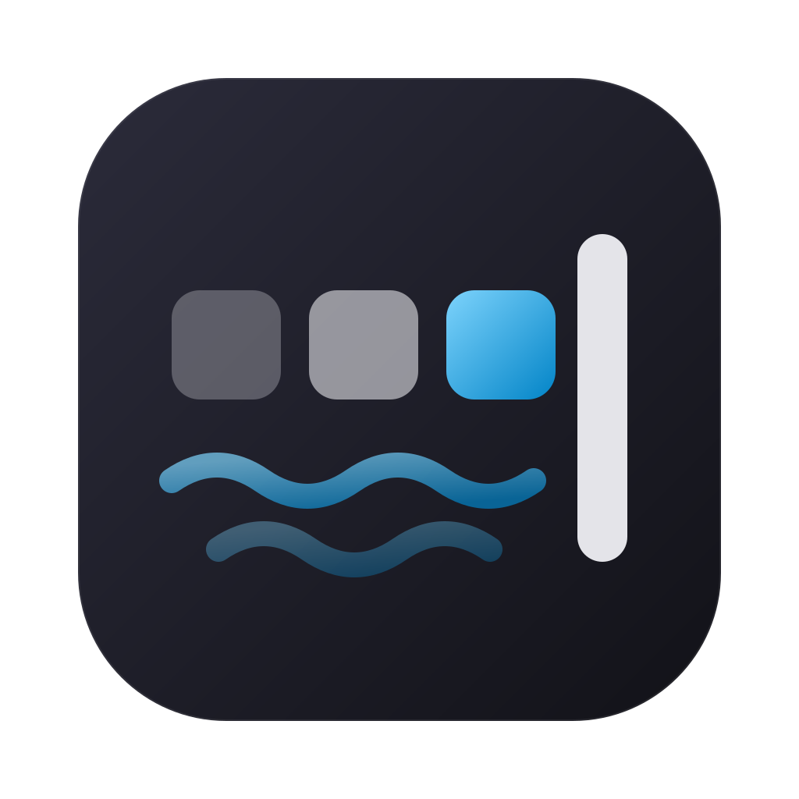
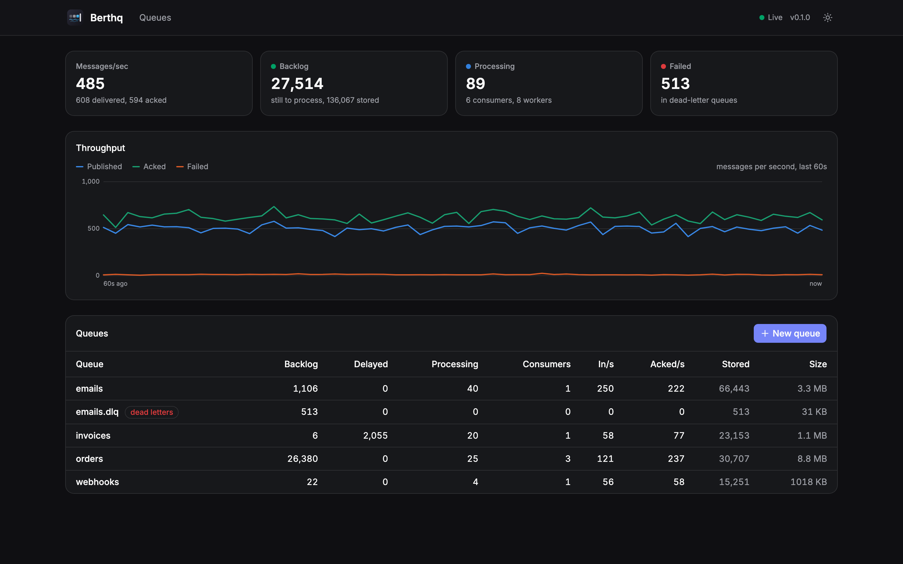
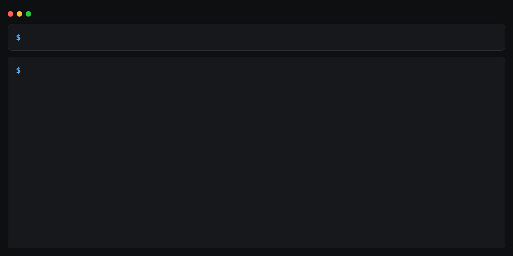
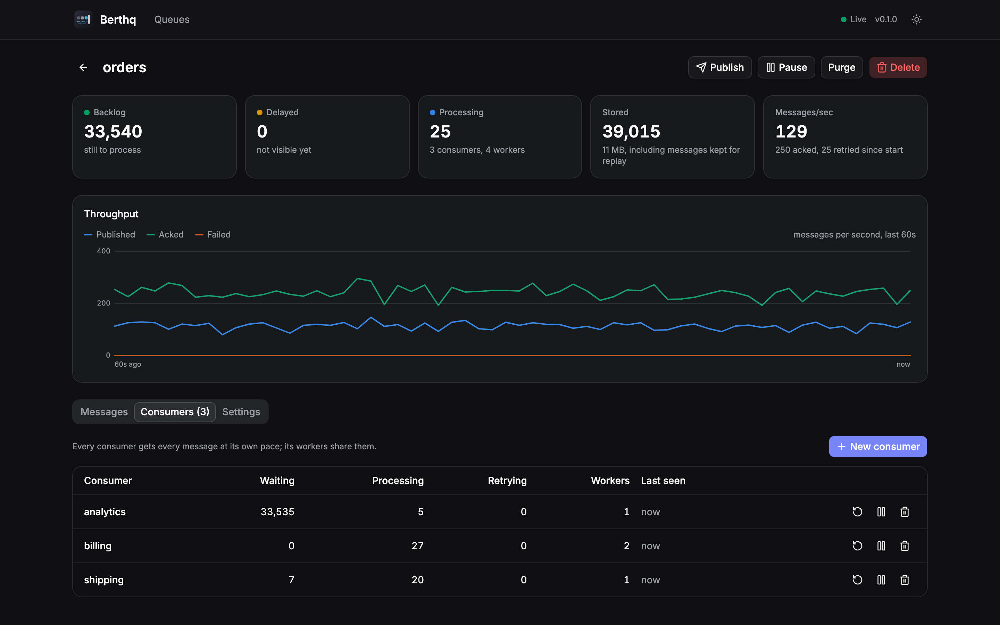
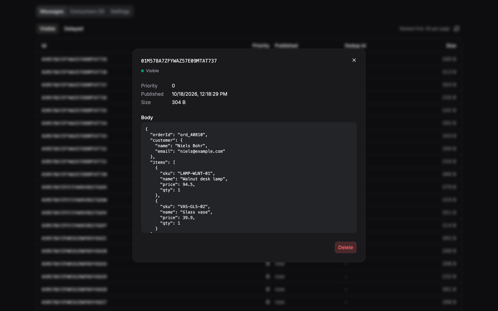

<p align="center">
  
</p>

<h1 align="center">Berthq</h1>

<p align="center">
  <b>An open-source message broker and job queue in one binary.</b><br />
  Persistent queues, retries, dead letters, delays, priorities, replay and a live dashboard.<br />
  A simple alternative to RabbitMQ, SQS and Redis queues. No Erlang, no JVM, no configuration files.
</p>

<p align="center">
  <a href="#quick-start">Quick start</a> ·
  <a href="#features">Features</a> ·
  <a href="#berthq-vs-rabbitmq-kafka-sqs-and-redis-queues">Comparison</a> ·
  <a href="docs/api.md">HTTP API</a> ·
  <a href="docs/guarantees.md">Guarantees</a> ·
  <a href="#faq">FAQ</a> ·
  <a href="docs/spec.md">How it works</a>
</p>

<p align="center">
  <a href="LICENSE"></a>
  
</p>

<!-- Screenshots and clips: see docs/screenshots/README.md for the shot list -->
<p align="center">
  
</p>

**Berthq** is a free, open-source (MIT), self-hosted **message broker** written in Rust. Start it
with one command and use it with `curl`: persistent queues with at-least-once delivery,
automatic retries with backoff, dead-letter queues, delayed and scheduled messages, priorities,
Kafka-style replay without partitions, Prometheus metrics and a built-in web dashboard. SDKs for PHP (with a **Laravel queue driver**), Node.js, Python, Go and
Rust. Memory stays flat no matter how deep your queues get.

## Quick start

<p align="center">
  
</p>

```sh
berthq start
berthq queue create emails
berthq publish emails '{"user":123}'
berthq consume emails
```

Open http://localhost:7331 for the dashboard (no `berthq` binary yet? See [Install](#install)). That's it: data lives in `./data`, and every
setting has a default.

```sh
berthq start --port 7331 --data ./data   # if you want to choose
```

Every consumer gets every message at its own pace, and can go back in time:

```sh
berthq consume emails --consumer audit           # a second service: starts from the oldest kept message
berthq consumer replay emails audit --from 2026-10-14T09:00:00Z
```

Or with Docker (a key is required, because the container listens on every address). Keep the
key. The dashboard asks for it, and the CLI and SDKs send it.

```sh
key=$(openssl rand -hex 24)
echo "API key: $key"
docker run -p 127.0.0.1:7331:7331 -v berthq-data:/data \
  -e BERTHQ_API_KEYS="admin:$key" ghcr.io/talovicnedim/berthq
```

On Kubernetes: [deploy/kubernetes/berthq.yaml](deploy/kubernetes/berthq.yaml) (one replica with
its own disk, keys from a Secret, a NetworkPolicy).

## Why Berthq

RabbitMQ is powerful but brings Erlang, plugins, exchanges and routing. Kafka can replay, but it
is a log, not a job queue, and wants partitions and a cluster. Redis-based queues lose messages
unless configured carefully. SQS is cloud-only.

Berthq gives you the job-queue features people actually use, plus Kafka-style replay without
partitions, with at-least-once delivery, in a single binary you can run on your laptop, in CI
and in production.

## Features

### Delivery you can trust

- Persistent queues: a publish returns only after it is on disk
- At-least-once delivery with leases: ack when done, nack to retry
- Automatic retries with exponential backoff, then a dead-letter queue (`emails.dlq`)
- Requeue dead letters with one click or `berthq queue requeue emails`
- Crash recovery: messages being processed when the broker stopped are retried, and count as
  an attempt
- Graceful shutdown waits for in-flight messages to be acked
- [Guarantees guide](docs/guarantees.md): how to never charge or email twice
- `berthq backup backup.redb`: a consistent copy while the broker keeps running
- Stops taking publishes before the disk is full (`--min-free-disk`, 1 GB by default), so
  workers can still drain the backlog

### Everything a job queue needs

- Priorities (0-9), delayed and scheduled messages (`--delay 10s`, `--at 2026-12-24T18:00:00Z`)
- Backlog limits (`--max-messages`) and deduplication ids
- Many workers per consumer sharing the messages; batch publish and consume
- Pause and resume a queue or one consumer without losing messages
- Five queue settings, all with sensible defaults: retention, visibility timeout, max attempts,
  retry delay and max messages

### Consumers and replay

<p align="center">
  
</p>

- Every consumer (`billing`, `audit`) gets every message and remembers its position; workers
  of one consumer share the work. No routing keys, no partitions, nothing copied
- Replay a consumer from the start, the end, a time or a message id
- Messages stay 24 hours by default (`--retention`), and never before every consumer is done
- `--auto-ack` for consumers that want speed over retries

### Security

- Safe by default: no network address without API keys. Keys have scopes (`admin`, `publish`,
  `consume`, `read`), and TLS needs no config file:
  `berthq start --api-key "$KEY" --tls-cert cert.pem --tls-key key.pem`

### Dashboard and monitoring

<p align="center">
  
</p>

- Built-in dashboard: throughput, backlog, consumers and how far behind they are, failures;
  inspect, publish, replay, purge, requeue
- Prometheus metrics at `/metrics`, live stats over server-sent events
- Memory stays flat no matter how deep your queues get: messages and their indexes live on disk

### HTTP API, CLI and SDKs

- A plain HTTP API that works with `curl` ([reference](docs/api.md))
- A CLI for scripts: `berthq consume emails --exec "./send-email.sh"` acks on exit code 0 and
  retries otherwise
- SDKs: [PHP with a Laravel queue driver](sdks/php), [Node.js / TypeScript](sdks/node),
  [Python](sdks/python), [Go](sdks/go), [Rust](sdks/rust)

## Berthq vs RabbitMQ, Kafka, SQS and Redis queues

- **RabbitMQ** is powerful, but you run Erlang, pick plugins and learn exchanges, bindings and
  routing. Berthq has one concept: queues with named consumers.
- **Kafka** can replay, but it is a log, not a job queue: retries, delays and dead letters are
  mostly up to you, and it wants partitions and a cluster. Berthq replays a consumer from a
  time or a message id, without partitions.
- **Amazon SQS** is great, but cloud-only. Berthq runs the same way on your laptop, in CI and on
  your own server, and keeps every message on your disk.
- **Redis-based queues** (BullMQ, Sidekiq, Laravel's Redis driver) can lose messages unless Redis
  is configured carefully. Berthq confirms a publish only after it is on disk.

Berthq is one node, run like Postgres: a durable disk, backups and fast restarts. Clustering,
AMQP, MQTT and Kafka wire protocols are [not goals for now](docs/spec.md#non-goals-for-now).

## Install

On macOS or Linux:

```sh
curl -fsSL https://raw.githubusercontent.com/talovicnedim/berthq/main/install.sh | sh
```

It downloads the latest release for your machine, checks its SHA-256 and installs `berthq` to
`/usr/local/bin` (or `~/.local/bin` when that isn't writable), without sudo.
`BERTHQ_VERSION=v0.1.0` picks a version and `BERTHQ_INSTALL_DIR` the folder. Read
[install.sh](install.sh) first if you like. On Linux the binaries need glibc 2.35 or newer
(Ubuntu 22.04, Debian 12, RHEL 10); on older or musl systems (Alpine), use the Docker image.

You can also run the Docker image (see [Quick start](#quick-start)), download a binary from the
[releases page](https://github.com/talovicnedim/berthq/releases/latest), or build from source
with [Rust](https://rustup.rs), Node 22.17+ and [pnpm](https://pnpm.io) 10:

```sh
pnpm install
pnpm build                    # dashboard + release binary
./target/release/berthq start
```

Every image and binary is built by GitHub Actions from a tagged commit, with a build
attestation. To check that a download really came from this repo:

```sh
gh attestation verify oci://ghcr.io/talovicnedim/berthq:0.1.0 --owner talovicnedim
gh attestation verify berthq-v0.1.0-linux-x86_64.tar.gz --owner talovicnedim
```

Homebrew is on the [roadmap](docs/spec.md#roadmap).

## Using it from code

The API is plain HTTP, so any language works:

```sh
# publish
curl -d '{"body":{"user":123}}' localhost:7331/v1/queues/emails/messages

# wait up to 20 s for up to 10 messages (consumer "default")
curl -d '{"max":10,"waitMs":20000}' localhost:7331/v1/queues/emails/consume

# the same for a second service with its own position
curl -d '{"consumer":"audit","max":10,"waitMs":20000}' localhost:7331/v1/queues/emails/consume

# done with one: send back its lease
curl -d '{"leases":["01J9Z….1.k3x9.default"]}' localhost:7331/v1/queues/emails/ack

# faster: ack the last batch and get the next one in the same request
curl -d '{"max":10,"waitMs":20000,"ack":["01J9Z….1.k3x9.default"]}' localhost:7331/v1/queues/emails/consume
```

The SDKs do the fast things for you. Their **publisher** sends messages in batches of up to
1000: a message goes out right away, and whatever arrives while that batch is on its way forms
the next one. Measured against one request per message: 1.4 times faster with 64 senders, 5
times with 512, and 13 times when 100,000 messages are sent at once. Their worker loops ack
inside the next consume call.

```ts
const publisher = client.publisher('emails');
await Promise.all(users.map((user) => publisher.publish({ body: { user: user.id } })));
await publisher.close();
```

### SDKs

| Language               | Install                                                                                                   |
| ---------------------- | --------------------------------------------------------------------------------------------------------- |
| PHP and Laravel        | `composer require berthq/berthq-php` ([docs](sdks/php))                                                   |
| Node.js and TypeScript | `npm install @berthq/client` ([docs](sdks/node))                                                          |
| Python                 | `pip install "git+https://github.com/talovicnedim/berthq#subdirectory=sdks/python"` ([docs](sdks/python)) |
| Go                     | `go get github.com/talovicnedim/berthq/sdks/go` ([docs](sdks/go))                                         |
| Rust                   | `berthq-client = { git = "https://github.com/talovicnedim/berthq" }` ([docs](sdks/rust))                  |

Laravel workers use the `berthq` queue driver:

```php
// config/queue.php
'connections' => [
    'berthq' => [
        'driver' => 'berthq',
        'url' => env('BERTHQ_URL', 'http://127.0.0.1:7331'),
        'key' => env('BERTHQ_API_KEY'),
        'queue' => env('BERTHQ_QUEUE', 'default'),
    ],
],
```

### Deduplication (`dedupId`)

Senders retry too: if the answer to a publish gets lost, your app doesn't know whether it worked
and sends again. Give the message a `dedupId` (your own label, like `order-42-created`), and a
repeat within an hour is not stored twice; Berthq answers with the first message's id:

```sh
curl -d '{"body":{"order":42},"dedupId":"order-42-created"}' localhost:7331/v1/queues/orders/messages
# 201 {"id":"01J…A","duplicate":false}
curl -d '{"body":{"order":42},"dedupId":"order-42-created"}' localhost:7331/v1/queues/orders/messages
# 200 {"id":"01J…A","duplicate":true}
```

This protects the sending side. A worker can still receive a message twice (a crash before its
ack); [docs/guarantees.md](docs/guarantees.md) shows how to make sure the work happens once.

## The CLI

```
berthq start [--host 127.0.0.1] [--port 7331] [--data ./data] [--min-free-disk 1GB]
             [--shutdown-timeout 10s] [--api-key scope+scope:KEY] [--no-auth]
             [--tls-cert cert.pem --tls-key key.pem]
berthq queue create <name> [--retention 24h] [--visibility-timeout 30s] [--max-attempts 5]
                           [--retry-delay 1s] [--max-messages 100000]
berthq queue list | get | update | delete | purge | pause | resume | requeue <name>
berthq publish <queue> <body|-> [--priority 5] [--delay 10s] [--at <time>] [--dedup-id id]
berthq consume <queue> [--consumer name] [--worker name] [--from start|end|<time>|<id>]
               [--count 10] [--auto-ack] [--exec "cmd"]
berthq consumer list <queue>
berthq consumer create <queue> <consumer> [--from start|end|<time>|<id>]
berthq consumer get | remove | pause | resume <queue> <consumer>
berthq consumer replay <queue> <consumer> --from start|end|<time>|<id>
berthq messages <queue> [--consumer name --state processing] [--id <id>]
berthq backup <file>
berthq stats
```

Every flag of `berthq start` also reads an env var (`BERTHQ_PORT`, `BERTHQ_DATA`,
`BERTHQ_API_KEYS`, …). Client commands talk to `BERTHQ_URL` (default `http://127.0.0.1:7331`),
send `BERTHQ_API_KEY` (or `--key`), and print JSON with `--json`.

## How it works

One process, one data file. Messages, bodies, every consumer's position and the sorted indexes
that decide what is delivered next are stored in [redb](https://github.com/cberner/redb), an
embedded ACID database.
A single writer thread commits concurrent publishes, deliveries and acks together ("group
commit"), so every change is fsynced before it is confirmed without paying one disk flush per
message. See [docs/spec.md](docs/spec.md) for the delivery semantics and design decisions.

Measured on an M1 Pro laptop with other apps running (release build, every write fsynced):

| What                                                | Speed           |
| --------------------------------------------------- | --------------- |
| Publish in batches of 1000                          | ~150,000 msgs/s |
| SDK publisher, 100,000 messages sent at once        | ~77,000 msgs/s  |
| Consume 100 at a time, acks inside the next consume | ~45,000 msgs/s  |
| Consume 100 at a time, acks as separate requests    | ~24,000 msgs/s  |
| A second consumer replaying with auto-ack           | ~60,000 msgs/s  |
| Single publishes, 1,024 requests in flight          | ~62,000 msgs/s  |
| Single publishes, 128 requests in flight            | ~11,000 msgs/s  |

Every single publish waits for the disk, but concurrent ones share a flush, so more requests in
flight means more speed: at 1,024 the durable broker matched a test build that never flushes,
and the limit was the laptop's CPU. Memory starts at about 4 MB and grows to about 100 MB under
heavy publishing, then stays there however deep the queues get. With 512 requests in flight it
peaked at about 115 MB, and with 1,024 at about 140 MB.

## FAQ

### Is Berthq a good RabbitMQ alternative?

For job queues, yes: persistent queues, retries with backoff, dead letters, delays, priorities
and a dashboard, without Erlang, exchanges or routing. If you need AMQP, clustering or complex
routing, RabbitMQ is still the right tool.

### Can I use Berthq as a Laravel queue driver?

Yes. The [PHP SDK](sdks/php) registers a `berthq` queue driver for Laravel 11 and 12. Add a
connection to `config/queue.php` and run your workers with `php artisan queue:work berthq`.

### Does Berthq lose messages if it crashes?

No. A publish is confirmed only after it is fsynced to disk, and messages that were being
processed are delivered again after a restart. Delivery is at-least-once, so a worker can get a
message twice; [docs/guarantees.md](docs/guarantees.md) shows how to make sure the work happens
once.

### Does Berthq support exactly-once delivery?

No broker can promise it on its own. Berthq gives you stable message ids, leases and
deduplication on publish, and the [guarantees guide](docs/guarantees.md) shows the database
patterns that make the work happen exactly once.

### Can I replay messages like Kafka?

Yes. Every consumer has its own saved position. Move it to the start, the end, a point in time
or a message id, and it gets those messages again. Messages are kept for 24 hours by default.

### How much memory does Berthq use?

About 4 MB at start and about 100 MB under heavy publishing. With 512 requests in flight it
peaked at about 115 MB, and with 1,024 at about 140 MB. Messages and their indexes live on disk,
so memory doesn't grow with queue depth.

### Can I run Berthq on Kubernetes?

Yes. [deploy/kubernetes/berthq.yaml](deploy/kubernetes/berthq.yaml) runs one replica with its own
disk, API keys from a Secret and a NetworkPolicy.

## Development

```sh
pnpm install
cargo run -p berthq-cli -- start   # broker on :7331
pnpm dev                           # dashboard with hot reload on :5176
pnpm check                         # format, lint, types and tests
```

## What's next

- Recurring schedules (cron) on top of delayed messages
- `maxInFlight`: at most N messages of a queue being processed at once
- `berthq compact` to shrink the data file after a big spike
- Compressing large message bodies on disk
- Homebrew
- Order per key, and a standby copy on a second machine

See the [roadmap](docs/spec.md#roadmap) and the [changelog](CHANGELOG.md).

## Feedback and contributing

Found a bug or missing a feature? [Open an issue](https://github.com/talovicnedim/berthq/issues). Pull requests are
welcome; [CONTRIBUTING.md](CONTRIBUTING.md) explains how the code is organized.

If Berthq is useful to you, a star on GitHub helps other people find it.

## Related projects

Open-source, local-first tools built the same way:

- [Tugdeck](https://github.com/talovicnedim/tugdeck) - desktop GUI for Docker Swarm and Kubernetes
- [Rowcove](https://github.com/talovicnedim/rowcove) - database client with built-in diagnostics
- [Plumbq](https://github.com/talovicnedim/plumbq) - API client that keeps requests as `.http` files
- [Steerq](https://github.com/talovicnedim/steerq) - terminal workspace for AI coding agents

## License

[MIT](LICENSE)
